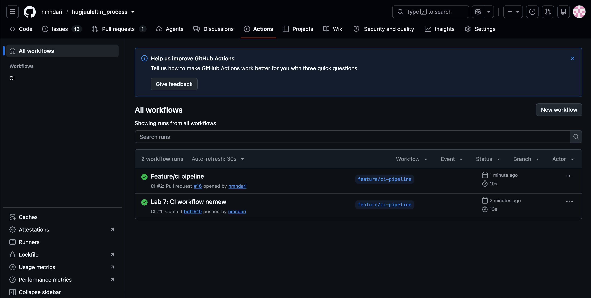
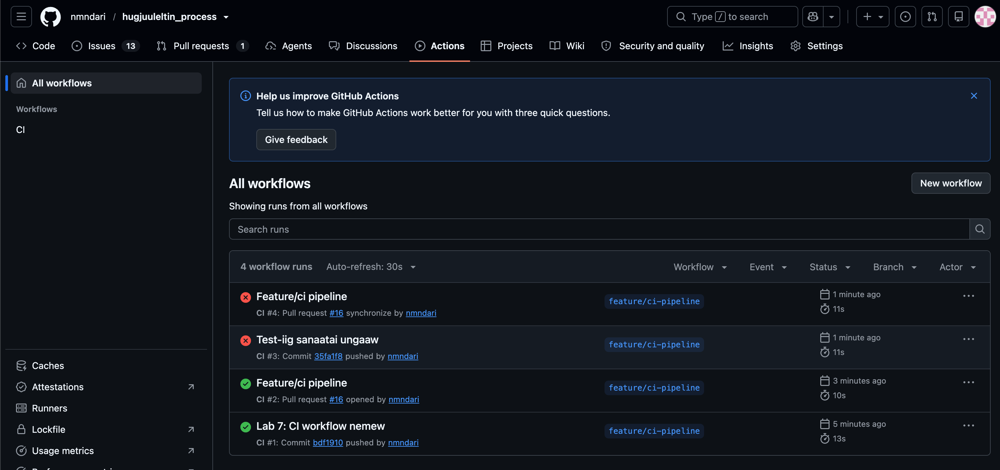

# Лабораторийн ажил 1. Хөгжүүлэлтийн орчин бүрдүүлэх ба Git-ашиглах

# Миний анхны төсөл

Энэ бол миний Программ хангамж хөгжүүлэлтийн процесс хичээлийн анхны төсөл.

## Багийн гишүүд

- С. Азжаргал (Product Owner) B232270052
- О. Оюунжаргал (Scrum Master) B232270019
- Б. Намуундарь (Хөгжүүлэгч) B232270037
- Г. Саранчимэг (Хөгжүүлэгч) B232274001

## Төслийн зорилго

Энэ төслөөр бид Scrum аргачлалыг дагаж, жижиг веб аппликейшн хөгжүүлэх болно.  
__doc файл__ : https://docs.google.com/document/d/1Qht7lOpRGM3PbTTURU7Waoi6FGdkeAePRMWBC2J-iZ0/edit?usp=sharing

---

# Лабораторийн ажил 2. Хэрэглэгчийн хэрэгцээг ойлгох ба User Story бичих

Сэдэв : СӨХ-ийн удирдлагын веб/мобайл аппликейшн

## Проектийн зорилго, хамрах хүрээг тодорхойлох

### Бид ямар асуудлыг шийдэх гэж байна вэ?
Сар болгоны хуримтлуулагдаж буй мөнгө яаж зарцуулагдаж байгаа талаар мэдээлэл, тайлан ил тод байдаггүй болохоор маргаан оршин суугчдын дунд үүсдэг. СӨХ-ийн хурлын ирц хангалтгүй, оролцоо дутуу байдаг тул энэхүү асуудлыг шийдэх зорилготой.

### Бидний бүтээх зүйл хэнд, ямар тусламж үзүүлэх вэ?
Оршин суугчдад СӨХ-ийн үйл ажиллагааг нээлттэй, ил тод байлгах, оролцоог нэмэгдүүлэх, санхүүжилт хэрхэн зарцуулагдаж байгааг мэдэх, санал гомдлоо хялбараар хуваалцахад туслана.

### Манай бүтээгдэхүүний гол онцлог, үндсэн функцууд юу вэ?
Санхүүгийн тайлан харах, гомдол гаргах, зар мэдээ оруулах, засвар үйлчилгээний хүсэлт байршуулах, төлбөр төлөх

---

## Багийн хамт User Story-ууд бичих

1. Оршин суугчийн хувьд, би сар бүрийн СӨХ-ийн төлбөр болон төлсөн төлбөрийн түүхээ харахыг хүсэж байна, ингэснээр өөрийн төлбөрийн мэдээллээ хянах боломжтой болно.
2. Оршин суугчийн хувьд, би СӨХ-ийн зарцуулалтын дэлгэрэнгүй мэдээллийг харахыг хүсэж байна, ингэснээр ямар зүйлд хэдий хэмжээний мөнгө зарцуулсныг ойлгох боломжтой болно.
3. Оршин суугчийн хувьд, би СӨХ-ийн хурлын огноо, цагийг харахыг хүсэж байна, ингэснээр хуралдаа урьдчилан бэлдэх боломжтой болно.
4. Оршин суугчийн хувьд, би СӨХ-ийн шийдвэрүүд дээр апп-аар санал өгөхийг хүсэж байна, ингэснээр хуралд биечлэн оролцож чадахгүй байсан ч шийдвэр гаргалтад оролцох боломжтой болно.
5. Оршин суугчийн хувьд, би байртай холбоотой асуудлыг апп-аар мэдэгдэхийг хүсэж байна, ингэснээр асуудлыг СӨХ-д хурдан хүргэж шийдвэрлүүлэх боломжтой болно.
6. Оршин суугчийн хувьд, би төлбөрийн хугацаа болон СӨХ-ийн зарлалуудын талаар мэдэгдэл авахыг хүсэж байна, ингэснээр чухал мэдээллийг алдахгүй байх боломжтой болно.
7. СӨХ-ийн гишүүний хувьд, би өмнөх саруудын санхүүгийн тайланг харахыг хүсэж байна, ингэснээр СӨХ-ийн санхүүгийн өөрчлөлтийг харьцуулан хянах боломжтой болно.
8. СӨХ-ийн гишүүний хувьд, би зарлал мэдээлэл оруулахыг хүсэж байна. Ингэснээр оршин суугчдад чухал мэдээллийг цаг тухайд нь хүргэх боломжтой болно.
9. СӨХ-ийн гишүүний хувьд, би зардлын мэдээллийг оруулахыг хүсэж байна. Ингэснээр оршин суугчдад сар бүрийн зардлын тайланг ил тод харуулах боломжтой болно.
10. СӨХ-ийн гишүүний хувьд, би СӨХ-ийн хурлын мэдээлэл оруулахыг хүсэж байна. Ингэснээр оршин суугчдад хурлын өдөр, цагийг урьдчилан мэдэгдэх боломжтой болно.
11. СӨХ-ийн гишүүний хувьд, би санал асуулга үүсгэхийг хүсэж байна. Ингэснээр оршин суугчдын саналыг цахимаар авах боломжтой болно.

---

## INVEST зарчмыг хэрэглэх, шалгах

| ID | I | N | V | E | S | T | Тайлбар |
|---|:-:|:-:|:-:|:-:|:-:|:-:|---|
| US_01 | ✓ | ✓ | ✓ | ✓ | ✓ | ✓ | Бие даан хөгжүүлэгдэх, төлбөр харагдаж байгаагаар тестлэгдэнэ |
| US_02 | ✓ | ✓ | ✓ | ✓ | ✓ | ✓ | US_09-тэй өгөгдлийн хамааралтай ч тусад нь хийгдэнэ |
| US_03 | ✓ | ✓ | ✓ | ✓ | ✓ | ✓ | Жижиг, тодорхой |
| US_04 | ✓ | ✓ | ✓ | ✓ | ✓ | ✓ | Санал өгөх үйлдэл нь ил тод тестлэгдэнэ |
| US_05 | ✓ | ✓ | ✓ | ✓ | ✓ | ✓ | Асуудал илгээх, төлөв харах гэж задлах боломжтой |
| US_06 | ✓ | ✓ | ✓ | ✓ | ✓ | ✓ | Мэдэгдэл хүрсэн эсэхээр тестлэгдэнэ |
| US_07 | ✓ | ✓ | ✓ | ✓ | ✓ | ✓ | US_09-ийн өгөгдөл дээр тулгуурлана |
| US_08 | ✓ | ✓ | ✓ | ✓ | ✓ | ✓ | Бие даасан, жижиг |
| US_09 | ✓ | ✓ | ✓ | ✓ | ✓ | ✓ | Бие даасан, жижиг |
| US_10 | ✓ | ✓ | ✓ | ✓ | ✓ | ✓ | US_03-ын хосолсон админ тал |
| US_11 | ✓ | ✓ | ✓ | ✓ | ✓ | ✓ | US_04-өөс өмнө хийгдэх шаардлагатай |

## Бүтээгдэхүүний backlog

Бүтээгдэхүүний Backlog-ийг Google Sheets (https://docs.google.com/spreadsheets/d/1SVqEy0BkiJ6NejVOk7V7kBhurjooAqRewIouDOekrws/edit?usp=sharing) болон Github Project дээр үүсгэсэн.


| ID | User Story | Priority | Notes |
|:---:|---|:---:|:---:|
| US_01 | Оршин суугчийн хувьд, би сар бүрийн СӨХ-ийн төлбөр болон төлсөн төлбөрийн түүхээ харахыг хүсэж байна, ингэснээр өөрийн төлбөрийн мэдээллээ хянах боломжтой болно. | High | Must have |
| US_02 | Оршин суугчийн хувьд, би СӨХ-ийн зарцуулалтын дэлгэрэнгүй мэдээллийг харахыг хүсэж байна, ингэснээр ямар зүйлд хэдий хэмжээний мөнгө зарцуулсныг ойлгох боломжтой болно. | High | Must have |
| US_03 | Оршин суугчийн хувьд, би СӨХ-ийн хурлын огноо, цагийг харахыг хүсэж байна, ингэснээр хуралдаа урьдчилан бэлдэх боломжтой болно. | Medium | Should have |
| US_04 | Оршин суугчийн хувьд, би СӨХ-ийн шийдвэрүүд дээр онлайнаар санал өгөхийг хүсэж байна, ингэснээр хуралд биечлэн оролцож чадахгүй байсан ч шийдвэр гаргалтад оролцох боломжтой болно. | High | Must have |
| US_05 | Оршин суугчийн хувьд, би байртай холбоотой асуудлыг апп-аар мэдэгдэхийг хүсэж байна, ингэснээр асуудлыг СӨХ-д хурдан хүргэж шийдвэрлүүлэх боломжтой болно. | High | Should have |
| US_06 | Оршин суугчийн хувьд, би төлбөрийн хугацаа болон СӨХ-ийн зарлалуудын талаар мэдэгдэл авахыг хүсэж байна, ингэснээр чухал мэдээллийг алдахгүй байх боломжтой болно. | Medium | Must have |
| US_07 | СӨХ-ийн гишүүний хувьд, би өмнөх саруудын санхүүгийн тайланг харахыг хүсэж байна, ингэснээр СӨХ-ийн санхүүгийн өөрчлөлтийг харьцуулан хянах боломжтой болно. | High | Must have |
| US_08 | СӨХ-ийн гишүүний хувьд, би зарлал мэдээлэл оруулахыг хүсэж байна. Ингэснээр оршин суугчдад чухал мэдээллийг цаг тухайд нь хүргэх боломжтой болно. | High | Must have |
| US_09 | СӨХ-ийн гишүүний хувьд, би зардлын мэдээллийг оруулахыг хүсэж байна. Ингэснээр оршин суугчдад сар бүрийн зардлын тайланг ил тод харуулах боломжтой болно. | High | Must have |
| US_10 | СӨХ-ийн гишүүний хувьд, би СӨХ-ийн хурлын мэдээлэл оруулахыг хүсэж байна. Ингэснээр оршин суугчдад хурлын өдөр, цагийг урьдчилан мэдэгдэх боломжтой болно. | High | Should have |
| US_11 | СӨХ-ийн гишүүний хувьд, би санал асуулга үүсгэхийг хүсэж байна. Ингэснээр оршин суугчдын саналыг цахимаар авах боломжтой болно. | High | Must have |


# Лабораторийн ажил №3 — User Story-г үнэлэх ба эхний Sprint төлөвлөх

## Алхам 1: Суурь (Baseline) Story сонгох

**Сонгосон User Story — US_03:**

> *"Оршин суугчийн хувьд, би СӨХ-ийн хурлын огноо, цагийг харахыг хүсэж байна, ингэснээр хуралдаа урьдчилан бэлдэх боломжтой болно."*

**Яагаад энэ user story вэ?**
Энэ нь зөвхөн хурлын огноо, цагийн мэдээллийг хэрэглэгчид харуулах шаардлагатай тул backlog дахь хамгийн энгийн story-уудын нэг юм.

**Тогтоосон үнэлгээ:** `1 Story Point` — бусад бүх story-г үүнтэй харьцуулан үнэлнэ.

---

## Алхам 2: Planning Poker — бүх Story-гийн үнэлгээ

> User story-нуудад өгсөн үнэлгээ үзэх линк
> https://docs.google.com/spreadsheets/d/1SVqEy0BkiJ6NejVOk7V7kBhurjooAqRewIouDOekrws/edit?gid=0#gid=0

---

## Алхам 3: Багийн хүчин чадал (Capacity)

> **Хүчин чадал = (1 хүний өдрийн ажлын цаг × Багийн хүний тоо) × Sprint-ийн ажлын өдөр × Ашигтай цагийн коэффициент**

| Үзүүлэлт | Утга |
|---|---|
| Багийн гишүүд | 4 хүн |
| Өдөрт ажиллах хугацаа | 2 цаг |
| Sprint хугацаа | 2 долоо хоног (3 ажлын өдөр) |
| Ашигтай цагийн коэффициент | 0.5 (50%) |

**Тооцоолол:**

```
Хүчин чадал = 2 цаг × 4 хүн × 3 өдөр × 0.5 = 12 Story Point
```

**Нэг Sprint-ийн хүчин чадал: 12 SP**

---

## Алхам 4: Эхний Sprint-ийн Backlog

| ID | User Story | Priority | Story Point |
|---|---|:---:|:---:|
| US_01 | Оршин суугчийн хувьд, би сар бүрийн СӨХ-ийн төлбөр болон төлсөн төлбөрийн түүхээ харахыг хүсэж байна, ингэснээр өөрийн төлбөрийн мэдээллээ хянах боломжтой болно. | High | 3 SP |
| US_02 | Оршин суугчийн хувьд, би СӨХ-ийн зарцуулалтын дэлгэрэнгүй мэдээллийг харахыг хүсэж байна, ингэснээр ямар зүйлд хэдий хэмжээний мөнгө зарцуулсныг ойлгох боломжтой болно. | High | 3 SP |
| US_03 | Оршин суугчийн хувьд, би СӨХ-ийн хурлын огноо, цагийг харахыг хүсэж байна, ингэснээр хуралдаа урьдчилан бэлдэх боломжтой болно. | Medium | 1 SP |
| US_04 | Оршин суугчийн хувьд, би СӨХ-ийн шийдвэрүүд дээр онлайнаар санал өгөхийг хүсэж байна, ингэснээр хуралд биечлэн оролцож чадахгүй байсан ч шийдвэр гаргалтад оролцох боломжтой болно. | High | 2 SP |
| US_09 | СӨХ-ийн гишүүний хувьд, би зардлын мэдээллийг оруулахыг хүсэж байна. Ингэснээр оршин суугчдад сар бүрийн зардлын тайланг ил тод харуулах боломжтой болно. | High | 2 SP |
| | **Нийт** | | **11 SP** |

**Багтаамжийн шалгалт:** 11 SP ≤ 12 SP хүчин чадал (1 SP нөөцтэй)

---

## Алхам 5: GitHub Project дээрх Sprint-ийн удирдлага

Backlog-ийн бүх user story-г GitHub Project-ийн **Backlog** самбар дээр issue болгон бүртгэж, Sprint-үүдийг статусаар нь ялган удирддаг.

> GitHub Project (Backlog) самбар:
> https://github.com/nmndari/hugjuuleltin_process/projects

| Sprint | GitHub Project статус | User Story |
|---|:---:|---|
| **Sprint 1** (идэвхтэй) | `To do` | US_01, US_02, US_03, US_04, US_09 |
| Дараагийн Sprint-үүд | `Open` | US_05, US_06, US_07, US_08, US_10, US_11 |

**Ажлын урсгал:**
- `Open` — backlog-д хүлээгдэж буй, Sprint-д хараахан сонгогдоогүй story
- `To do` — идэвхтэй Sprint-д сонгогдож, хийгдэхээр төлөвлөгдсөн story
- Sprint дуусахад хийгдсэн story-г хааж, дараагийн багц story-г `Open`-оос `To do` руу шилжүүлнэ

---

## Алхам 6: Sprint Зорилго (Sprint Goal)

> ###  Sprint Goal
> **"Оршин суугчдад СӨХ-ийн төлбөр, санхүүгийн зарцуулалт, хурлын мэдээллийг харах, СӨХ-ийн шийдвэрт онлайнаар санал өгөх болон СӨХ-ийн гишүүдэд зардлын мэдээлэл оруулах боломжийг бүрдүүлэх."**

# Лаборатори 6: Git Branching, Merge Conflict

## Зорилго

1. Feature branch үүсгэж, ажиллаж, main руу нэгтгэх дадлага хийх
2. Санаатайгаар merge conflict үүсгэж, шийдвэрлэх
3. Pull Request үүсгэж, main руу нэгтгэх

## Шаардлагатай хэрэгсэл

- Git
- GitHub (Pull Request)

## Багийн гишүүд

| Гишүүн | GitHub | Branch |
|--------|--------|--------|
| Хүн A: С. Азэаргал | azaan1134 | `feature/greeting` |
| Хүн B: Б. Намуундарь | nmndari | `feature/greeting-namuun` |

## Алхам алхмаар гүйцэтгэл

### 0. Бэлтгэл

Хоёулаа repository-г clone хийсэн:

```bash
git clone https://github.com/nmndari/hugjuuleltin_process.git
cd hugjuuleltin_process
```

Хүн A conflict үүсгэх суурь файл `greeting.py`-г main руу нэмсэн (commit `c83aaa4`).


### 1. Feature branch үүсгэх (хоёулаа тусдаа)

Хоёулаа ижил суурь commit (`c83aaa4`) дээрээс тусдаа branch үүсгэсэн.

**Хүн A:**

```bash
git checkout -b feature/greeting
# greeting.py-ийн 2-р мөрийг өөрчилнө
git commit -am "greeting.py file zasaw"
git push -u origin feature/greeting
```

**Хүн B:**

```bash
git checkout -b feature/greeting-namuun c83aaa4
# greeting.py-ийн 2-р мөрийг өөрчилнө
git commit -am "Change greeting message (Namuun)"
git push -u origin feature/greeting-namuun
```

### 2. Санаатайгаар conflict үүсгэх

Хоёр хүн нэг файлын (`greeting.py`) нэг мөрийг (2-р мөр) өөр өөрөөр өөрчилсөн:

| Гишүүн | Branch | 2-р мөр |
|--------|--------|---------|
| Хүн A | `feature/greeting` | `message = "Сайн байна уу"` |
| Хүн B | `feature/greeting-namuun` | `message = "Hi there"` |

Нэг branch main руу merge хийгдсэний дараа нөгөө branch conflict өгнө.

### 3. Pull Request үүсгэх

GitHub дээр **Pull requests → New pull request**:

- Хүн A: `feature/greeting` → `main` (PR #14)
- Хүн B: `feature/greeting-namuun` → `main` (PR #15)

Тайлбар дээр юу өөрчилснөө бичсэн.

### 4. Эхний PR-ийг merge хийх

Хүн A-ийн PR #14-ийг **Merge pull request** дарж main руу merge хийсэн (commit `bd7e25d`). Үүний дараа Хүн B-ийн PR дээр GitHub *"This branch has conflicts that must be resolved"* гэж харуулсан.

### 5. Merge conflict шийдвэрлэх

Хүн B conflict-ийг өөрийн branch дээр local-д шийдсэн:

```bash
git checkout feature/greeting-namuun
git pull --no-rebase origin main
# Auto-merging greeting.py
# CONFLICT (content): Merge conflict in greeting.py
# Automatic merge failed; fix conflicts and then commit the result.
```

`greeting.py` нээхэд:

```
def greet(name):
<<<<<<< HEAD
    message = "Hi there"
=======
    message = "Сайн байна уу"
>>>>>>> bd7e25d
    return f"{message}, {name}!"
```

Хоёр гишүүн ярилцаж `"Сайн байна уу"` хувилбарыг үлдээхээр шийдсэн. Тэмдэглэгээг (`<<<<<<<`, `=======`, `>>>>>>>`) устгаад, файл ажиллаж байгааг шалгасан:

```bash
python3 greeting.py
# Сайн байна уу, World!
git add greeting.py
git commit -m "Merge conflict zasaw"
git push
```

Push хийсний дараа PR автоматаар шинэчлэгдэж, conflict арилсан.

### 6. Хоёр дахь PR-ийг merge хийх ба эцсийн шалгалт

Conflict шийдэгдсэний дараа Хүн B-ийн PR #15-ийг **Merge pull request** дарж main руу merge хийсэн.

```bash
git checkout main && git pull
git log --oneline --graph --all
```

Хоёр branch хоёулаа main-д орсныг баталгаажуулсан.

## Хүлээлгэн өгөх зүйл (deliverable)

Repository: https://github.com/nmndari/hugjuuleltin_process

- [x] 2 feature branch-ийн commit түүх (`feature/greeting`, `feature/greeting-namuun`)
- [x] Conflict шийдсэн merge commit (`5ddfcc9`)
- [x] 2 PR (merged төлөвтэй): #14, #15

## Дүгнэлт

Энэ лабораторийн ажлаар feature branch ашиглан бие даан ажиллах, merge conflict
гарсан үед хэрхэн шийдэх, Pull Request ашиглан өөрчлөлтөө main руу
нэгтгэх үйл явцыг практикаар сурсан.

---

# Лаборатори 7: GitHub Actions ашиглан CI Pipeline байгуулах

## Зорилго

1. GitHub Actions workflow файл бие даан бичих
2. Push, Pull Request trigger дээр автомат build/test ажиллуулах
3. CI pipeline-ийн амжилттай/амжилтгүй үр дүнг уншиж, тайлбарлах

## Шаардлагатай хэрэгсэл

- GitHub Actions
- Python 3.11, pytest

## Холбогдох файлууд

| Файл | Тайлбар |
|------|---------|
| [`.github/workflows/ci.yml`](.github/workflows/ci.yml) | CI workflow: checkout → setup → install → test |
| [`test_greeting.py`](test_greeting.py) | `greeting.py`-ийн үндсэн тестүүд |
| [`requirements.txt`](requirements.txt) | Хамаарал (pytest) |
| [`.gitignore`](.gitignore) | Кэш файлуудыг (`__pycache__/`, `.pytest_cache/`) хасах |

- Pull Request: [#16](https://github.com/nmndari/hugjuuleltin_process/pull/16)
- Actions: https://github.com/nmndari/hugjuuleltin_process/actions

## Алхам алхмаар гүйцэтгэл

### 1. Жишиг төсөл бэлдэх

Repository-д байсан `greeting.py`-г төсөл болгон ашиглаж, `test_greeting.py`-д 2 үндсэн тест бичсэн. `feature/ci-pipeline` branch үүсгээд local дээр тест ажиллуулж `2 passed` гэж шалгасан.

### 2–5. Workflow файл бичих

`.github/workflows/ci.yml` файлд `on: [push, pull_request]` trigger-тэй, **checkout → setup → install → test** гэсэн 4 алхамтай workflow бичсэн. Энэ нь ямар ч branch руу push хийх болон Pull Request нээх/шинэчлэх бүрт pipeline-г автоматаар ажиллуулна.

### 6. Push хийж, ажиллуулах

Файлуудаа commit хийж `feature/ci-pipeline` branch-аа push хийгээд, PR #16 (`feature/ci-pipeline` → `main`) нээсэн. Actions таб дээр workflow push болон pull_request trigger тус бүр дээр автоматаар эхэлсэн.

> **Тулгарсан асуудал:** Эхний push "token without `workflow` scope" алдаагаар татгалзагдсан. `.github/workflows/` доторх файлыг push хийхэд token-д `workflow` эрх шаардлагатай тул `repo` болон `workflow` эрхтэй шинэ classic token үүсгэж шийдсэн.

### 7. Амжилттай үр дүн

CI #1 (push) болон CI #2 (pull request) хоёулаа бүх алхмаа амжилттай (ногоон) дуусгасан.



### 8. Санаатайгаар унагаах

`test_greeting.py`-д хүлээгдэж буй утгыг `"Hello, World!"` болгож буруу утга оруулаад push хийсэн. CI #3 (push) болон CI #4 (pull request) хоёулаа улаан (амжилтгүй) болсон.



**Яагаад унасан бэ?** `greet("World")` функц `"Сайн байна уу, World!"` гэж буцаадаг, харин тест `"Hello, World!"` гэж хүлээж байсан. `Run tests` алхмын лог дээр `AssertionError` гарч, `1 failed, 1 passed` гэж харагдсан. pytest тест унасан тул тэгээс ялгаатай exit code буцааж, GitHub Actions `test` job-ийг амжилтгүй гэж тэмдэглэсэн. PR дээр "Some checks were not successful" гэж гарч, алдаатай код main руу орохоос сэргийлсэн.

### 9. Засварлаж, merge хийх

Тестийн утгыг `"Сайн байна уу, World!"` болгож буцааж засаад push хийхэд pipeline дахин ногоон болсон. Үүний дараа PR #16-г main руу merge хийсэн.

## Дүгнэлт

Энэ лабораторийн ажлаар GitHub Actions workflow бичиж, push болон Pull Request бүр дээр
тестийг автоматаар ажиллуулдаг CI pipeline байгуулсан. Тест унах үед pipeline улаан болж,
алдааны лог дээр яг аль тест, ямар утга зөрснийг харуулдаг тул алдааг merge хийхээс өмнө
илрүүлэх боломжтойг практикаар харсан.
